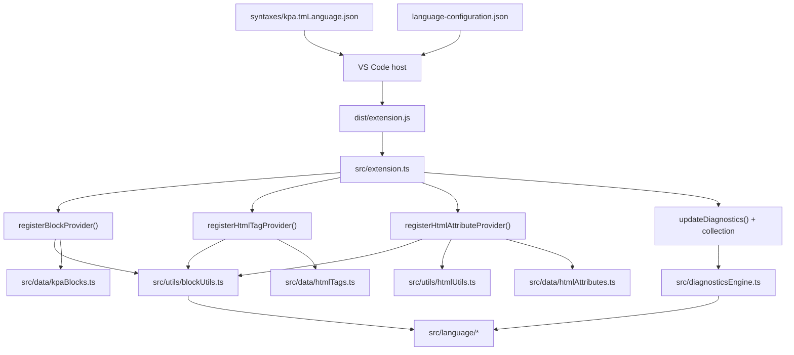

# Architecture

## Repository Classification

- Type: VS Code extension plugin
- Runtime responsibility: `.kpa` language registration, completions, and warning diagnostics
- Build-time responsibility: Webpack bundling, TypeScript compilation for tests, and repository validation
- UI surface: no standalone UI; behavior exists only inside the VS Code editor host
- Maturity: pre-1.0, intentionally narrow, with explicit specs and governance

## System Overview

`koppajs-vscode-extension` is a bundled VS Code extension that adds syntax highlighting, completions, and lightweight diagnostics for `.kpa` files. The runtime is intentionally simple and does not execute KoppaJS application code:

- `src/extension.ts` is the composition root.
- Completion providers handle block snippets, HTML tag snippets, and HTML attribute snippets.
- `src/language/` owns the internal parser-backed document model for `.kpa` files.
- `src/diagnosticsEngine.ts` applies diagnostics rules on parsed documents.
- `src/diagnostics.ts` maps pure diagnostics into VS Code warnings.
- Static metadata for completions lives in `src/data/`.
- Grammar and language configuration are declared through JSON files consumed by VS Code.

## Runtime Lifecycle

1. Opening a `.kpa` document triggers the explicit `onLanguage:kpa` activation event.
2. VS Code loads `dist/extension.js` and calls `activate()`.
3. `activate()` registers all completion providers and document event listeners.
4. Diagnostics are recalculated on document open, change, and active-editor change for `languageId === "kpa"`.
5. Providers compute suggestions based on current document position and static metadata.
6. `deactivate()` disposes the diagnostic collection.

## Module Responsibilities

| Module                                   | Responsibility                                                                               |
| ---------------------------------------- | -------------------------------------------------------------------------------------------- |
| `src/extension.ts`                       | Runtime composition root, provider registration, event wiring                                |
| `src/language/`                          | Internal parser-backed document model, source positions, and pure diagnostics rules          |
| `src/diagnosticsEngine.ts`               | Pure diagnostics entrypoint that parses `.kpa` text and applies language rules               |
| `src/diagnostics.ts`                     | `DiagnosticCollection` management and mapping from pure diagnostics into VS Code diagnostics |
| `src/providers/blockProvider.ts`         | Snippets for inserting top-level Koppa blocks                                                |
| `src/providers/htmlTagProvider.ts`       | HTML tag completions inside the canonical `[template]` block                                 |
| `src/providers/htmlAttributeProvider.ts` | HTML attribute completions inside opening HTML tags in `[template]`                          |
| `src/utils/blockUtils.ts`                | Shared pure helper logic for parser-backed block-context detection                           |
| `src/utils/htmlUtils.ts`                 | Shared pure helper logic for HTML opening-tag detection                                      |
| `src/data/kpaBlocks.ts`                  | Canonical block catalog plus compatibility aliases used for structural context decisions     |
| `src/data/*`                             | Static completion catalogs with no runtime side effects                                      |
| `syntaxes/kpa.tmLanguage.json`           | TextMate grammar for syntax highlighting and embedded language scopes                        |
| `language-configuration.json`            | Editor bracket, comment, and auto-closing behavior                                           |
| `src/test/unit/*`                        | Vitest unit tests for pure helpers                                                           |
| `src/test/integration/*`                 | VS Code extension-host integration tests                                                     |

Additional detail lives in [docs/architecture/module-boundaries.md](docs/architecture/module-boundaries.md).

## Architectural Invariants

- Only documents with `languageId === "kpa"` receive diagnostics.
- `src/extension.ts` is the only place that wires runtime services together.
- Providers return suggestions only; they do not mutate documents outside normal completion insertion.
- The internal `.kpa` parser is not yet a public package or stable external API.
- Static completion data remains plain data so it can be audited and updated without runtime coupling.
- Diagnostics are currently warning-level only.

## Canonical Block Semantics

The repository currently has three distinct semantics:

- Grammar-level syntax highlighting supports `[html]`, `[tpl]`, and `[template]` as HTML-like blocks.
- Structural block detection treats `[html]` and `[tpl]` as compatibility aliases so top-level block snippets are not offered inside them.
- Template-specific HTML completions and runtime diagnostics treat `[template]` as the canonical HTML block name.

This is intentional compatibility, not full feature parity. See [docs/adr/0003-canonicalize-template-block-for-editor-intelligence.md](docs/adr/0003-canonicalize-template-block-for-editor-intelligence.md).

## Build and Test Architecture

- TypeScript sources are bundled with Webpack into `dist/extension.js`.
- Integration test sources are compiled separately with `tsc` into `out/`.
- Vitest covers pure helper logic, parser behavior, and fixture-backed document tests.
- ESLint and Prettier form the static-analysis and formatting baseline.
- Husky and lint-staged protect staged files before commit.
- GitHub Actions runs the repository validation workflow on push and pull request.

## Known Gaps

- Compatibility aliases are still structural-only. Promoting `[html]` and `[tpl]` to full template-intelligence or diagnostics parity remains an explicit future decision.
- Syntax highlighting still relies on manual smoke checks because grammar behavior is expensive to assert comprehensively in automation.
