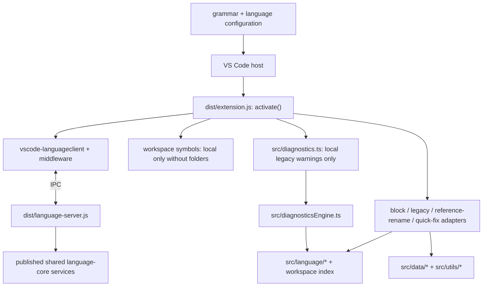

# Architecture

## Repository Classification

- Type: VS Code extension plugin
- Runtime responsibility: `.kpa` language registration, shared-server services, and retained local editor providers
- Build-time responsibility: Webpack bundling, TypeScript compilation for tests, and repository validation
- UI surface: no standalone UI; behavior exists only inside the VS Code editor host
- Maturity: 1.x release candidate, intentionally narrow, with explicit specs and governance

## System Overview

`koppajs-vscode-extension` is a bundled VS Code extension with a hybrid language-tooling runtime. It does not execute KoppaJS application code:

- `src/extension.ts` is the composition root for both local providers and a `vscode-languageclient` IPC client.
- `dist/language-server.js` bundles the published `@koppajs/koppajs-language-server` entry. Shared runtime language services, including current `{{...}}` interpolations over the returned controller contract, run through that server.
- The server owns runtime expressions, HTML/component completions, component hover/definition and document symbols. Local adapters own block snippets, legacy `{...}` intelligence, component/script reference and rename mappings, and component quick fixes. Workspace symbols use the server when folders are open and the local index in an empty editor window; middleware prevents duplicate owners.
- `src/language/` retains a local parser, symbol/semantic helpers, component analysis, and workspace index for those adapters and unit tests. These coexist with the published shared language packages; they are not the sole ecosystem language core.
- `src/diagnosticsEngine.ts` aggregates local pure rules. `src/diagnostics.ts` publishes only its uncoded legacy missing-binding messages, not every local engine result. Structural, runtime-binding, and component diagnostics reach the editor through the server.
- Static completion metadata lives in `src/data/`; grammar and language configuration are JSON consumed by VS Code.
- Published Core/check 0.2.2 already emit English. A narrow legacy compatibility fallback stays at the adapter boundary: `src/providers/englishPresentation.ts` maps known server diagnostics, rename errors, and matching HTML completion documentation without changing server ownership. `src/language/englishMessages.cjs` shares the message mapping with the repository CLI adapter in `scripts/kpa-check.mjs`; it does not modify installed language packages.

## Runtime Lifecycle

1. Opening a `.kpa` document triggers the explicit `onLanguage:kpa` activation event.
2. VS Code loads `dist/extension.js` and calls `activate()`.
3. Activation registers the local workspace index and providers, then starts the shared language server over IPC for `file` and `untitled` KPA documents.
4. Middleware routes completion/hover/definition in legacy expressions to local adapters, and routes script/component reference/rename requests to the matching local owner. Runtime `{{...}}` requests remain server-owned. Prop/import code actions are handled locally without duplicate server fixes; workspace-symbol ownership depends on the presence of workspace folders.
5. The local diagnostic collection refreshes on open, text change, and active-editor change and removes closed documents. The client also synchronizes KPA/script/config file watchers with the server.
6. `deactivate()` stops the language client and disposes the local diagnostic collection; context subscriptions own provider and listener disposal.

## Module Responsibilities

| Module                                         | Responsibility                                                                            |
| ---------------------------------------------- | ----------------------------------------------------------------------------------------- |
| `src/extension.ts`                             | Hybrid composition root, local registrations, language client/middleware and event wiring |
| `src/language/`                                | Retained local parser, symbols, semantics, component analysis, and workspace index        |
| `src/diagnosticsEngine.ts`                     | Pure diagnostics entrypoint that parses `.kpa` text and applies language rules            |
| `src/diagnostics.ts`                           | Local collection emitting filtered legacy missing-binding warnings only                   |
| `src/providers/blockProvider.ts`               | Snippets for inserting top-level Koppa blocks                                             |
| `src/providers/providerOwnership.ts`           | Shared local/LSP ownership checks for legacy and reference/rename requests                |
| `src/providers/componentCodeActionProvider.ts` | Safe explicit Prop/import/slot/emit repairs checked against current component information |
| `src/utils/blockUtils.ts`                      | Shared pure helper logic for parser-backed block-context detection                        |
| `src/utils/htmlUtils.ts`                       | Shared pure helper logic for HTML opening-tag detection                                   |
| `src/data/kpaBlocks.ts`                        | Canonical block catalog plus compatibility aliases used for structural context decisions  |
| `src/data/*`                                   | Static completion catalogs with no runtime side effects                                   |
| `syntaxes/kpa.tmLanguage.json`                 | TextMate grammar for syntax highlighting and embedded language scopes                     |
| `language-configuration.json`                  | Editor bracket, comment, and auto-closing behavior                                        |
| `src/test/unit/*`                              | Vitest unit tests for pure helpers                                                        |
| `src/test/integration/*`                       | VS Code extension-host integration tests                                                  |

Unregistered local HTML and document-symbol modules remain in the source tree but are not runtime owners. Active local adapters preserve legacy semantic mappings and safe explicit component repairs; the separately bundled server supplies the shared runtime path.

Additional detail lives in [docs/architecture/module-boundaries.md](docs/architecture/module-boundaries.md).

## Architectural Invariants

- Only documents with `languageId === "kpa"` receive diagnostics.
- `src/extension.ts` is the only place that wires runtime services together.
- Providers return completion items, navigation/symbol results, or explicit rename/code-action `WorkspaceEdit`s; they do not perform automatic repairs.
- The retained local parser is internal; published shared language packages already provide the server/CLI language core. Do not conflate the two implementations.
- CLI parity covers the shared server/core path. Local legacy `{...}` missing-binding warnings are an editor-only exception.
- Static completion data remains plain data so it can be audited and updated without runtime coupling.
- Diagnostics are currently warning-level only.

## Canonical Block Semantics

The repository currently has three distinct semantics:

- Grammar-level syntax highlighting supports `[html]`, `[tpl]`, and `[template]` as HTML-like blocks.
- Structural block detection treats `[html]` and `[tpl]` as compatibility aliases so top-level block snippets are not offered inside them.
- Template-specific HTML completions and runtime diagnostics treat `[template]` as the canonical HTML block name.

This is intentional compatibility, not full feature parity. See [docs/adr/0003-canonicalize-template-block-for-editor-intelligence.md](docs/adr/0003-canonicalize-template-block-for-editor-intelligence.md).

## Build and Test Architecture

- TypeScript 6 sources use Node16 package-export resolution; `src/package.json` explicitly keeps the source and integration-test output CommonJS while root tooling stays ESM. Webpack compiles source modules as ESM internally and emits static CommonJS exports into `dist/extension.js`, keeping `activate`/`deactivate` visible to the VS Code ESM loader after minification.
- Integration test sources are compiled separately with `tsc` into `out/`.
- `postinstall` runs `scripts/prepare-languageclient.mjs`, a version/hash-guarded two-check adaptation of client 11.0.0 to minimatch 11.0.3. It modifies installed dependency sources before bundling, never editor registration or shared language logic. See ADR 0006 and the dependency compatibility spec.
- Vitest covers pure helper logic, parser behavior, and fixture-backed document tests.
- ESLint and Prettier form the static-analysis and formatting baseline.
- Husky and lint-staged protect staged files before commit.
- GitHub Actions runs the repository validation workflow on push and pull request.

## Known Gaps

- Compatibility aliases are still structural-only. Promoting `[html]` and `[tpl]` to full template-intelligence or diagnostics parity remains an explicit future decision.
- Syntax highlighting still relies on manual smoke checks because grammar behavior is expensive to assert comprehensively in automation.
